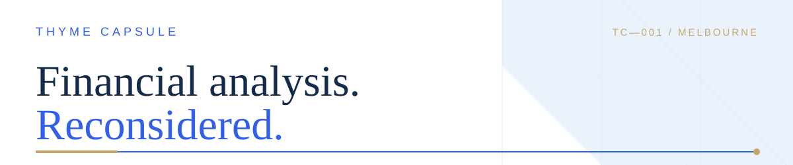

  

  

  Independent financial analysis across valuation, banking, capital markets and financial modelling.

---

  

| **01 / VALUATION** | **02 / BANKING** |
|---|---|
| DCF, NAV, residual income, financial statements and transaction analysis. | Bank models, credit risk, provisioning and lending. |
| **03 / MARKETS** | **04 / QUANTITATIVE** |
| Equities, debt issuance, fixed income and funding structures. | Financial modelling, scenarios, sensitivity and data analysis. |

  

**CASE 001 / CORPORATE VALUATION**

### Signet Jewelers

*Unlevered DCF · Gordon growth · Exit-multiple approaches*

[EXCEL MODEL ↗](https://github.com/ThymeCapsule/investment-banking-portfolio/blob/main/valuation-case-studies/signet-jewelers/Signet_DCF_Reviewed.xlsx) · [VALUATION SUMMARY ↗](https://github.com/ThymeCapsule/investment-banking-portfolio/blob/main/valuation-case-studies/signet-jewelers/Signet_Valuation_Summary_Reviewed.pdf)

---

**CASE 002 / ASSET VALUATION**

### Northern Star Resources

*Forecast-period asset NAV*

[EXCEL MODEL ↗](https://github.com/ThymeCapsule/investment-banking-portfolio/blob/main/valuation-case-studies/northern-star-resources/Northern_Star_Forecast_Period_NAV_Reviewed.xlsx) · [VALUATION SUMMARY ↗](https://github.com/ThymeCapsule/investment-banking-portfolio/blob/main/valuation-case-studies/northern-star-resources/Northern_Star_Valuation_Summary_Reviewed.pdf)

---

**CASE 003 / BANK VALUATION**

### NatWest Group

*Excess-return · Residual-income valuation*

[EXCEL MODEL ↗](https://github.com/ThymeCapsule/investment-banking-portfolio/blob/main/valuation-case-studies/natwest-group/NatWest_Excess_Return_Model_Reviewed.xlsx) · [VALUATION SUMMARY ↗](https://github.com/ThymeCapsule/investment-banking-portfolio/blob/main/valuation-case-studies/natwest-group/NatWest_Valuation_Summary_Reviewed.pdf)

---

**PORTFOLIO INDEX**

[Investment Banking & Valuation Portfolio ↗](https://github.com/ThymeCapsule/investment-banking-portfolio)

  

I prioritise transparent assumptions, source-backed inputs, auditable calculations, sensitivity analysis and explicit disclosure of model limitations. Company disclosures, market observations and analyst assumptions are distinguished rather than blended.

- Source-backed financial inputs
- Transparent modelling assumptions
- Auditable calculations and valuation outputs
- Sensitivity analysis and scenario testing

  

**Programming & modelling**

Excel · Python · R

**Financial analysis**

Corporate valuation · Financial modelling · Financial statement analysis · Fixed income · Credit analysis · Scenario analysis

---

Independent educational portfolio work. These projects are not investment research, investment advice, price targets or recommendations, and do not represent the views of any employer or client.
